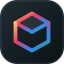

<div align="center">



# AkulavBox

**Your own cloud, your own apps.** AkulavBox is a self-hosted home for five apps that share **one account and one storage space**: Trove (encrypted files, photos, music, videos and books), e-Management (documents), Koma Shelf (webtoons), Florin (budgets) and Tick (to-dos). One Node.js server, one data folder, and an **AI connector** so Claude can work with all of them.

[](https://github.com/Akulav/akulavbox/actions/workflows/ci.yml)


Made with ♥ by **Akulav**

</div>

---

## The apps

AkulavBox is the account and the server, the way a Google account holds Gmail and Drive: each app has its own name. Signing in at `/login` opens the launcher at `/`, which shows the apps your account may use and how much of your storage each one takes:

| App | Address | What it is |
| --- | --- | --- |
| **Trove** | `/box/` | Files, photos, music, videos and books, encrypted at rest (the core; every account has it) |
| **e-Management** | `/docs/` | Personal and work documents with categories, tags, attachments, an activity log and per-space backups (in Romanian) |
| **Koma Shelf** | `/manga/` | Webtoons made with [Koma](https://github.com/Akulav/text-to-manga): a private library, unlisted links and a public shelf, with a reader built for long strips |
| **Florin** | `/budget/` | Expenses and income in any currency, budgets per category, and charts |
| **Tick** | `/tasks/` | To-dos with lists, tags, checklists, due dates and repeats, as a list, a board or a calendar |

- **One account, one sign-in.** Accounts live in AkulavBox's database. Signing in, out, changing a password, or "sign out everywhere" applies to every app at once.
- **The Admin console** (`/admin`, admins only) manages accounts for all apps: create and delete them, reset passwords, change roles, sign people out, turn each app on or off per account, set the size of each account's storage, optionally limit an app inside it, and choose the defaults for new accounts.
- **One storage space per account.** What Trove, e-Management and Koma Shelf store all counts towards it, like a Google account's storage.
- **AI connectors** (`/connect`): let Claude (on the web, desktop or phone, through its custom connectors) or Claude Code and any other MCP client read your apps and, if you allow it per app, change them. Tokens or a one-click OAuth sign-in; every app is covered.
- **Each app keeps its data in its own folder** of the data folder, and full backups carry all of them.

## Features

| | |
| --- | --- |
| **Files** | Folders, drag and drop, chunked uploads up to 50 GB per file (3 files in parallel, cancel or retry each one), **folder uploads**, search, zip downloads of any selection, public share links, and in-browser previews and editing of text, code, Markdown, CSV, JSON, Word, Excel, PDF, and zip files |
| **Trash** | Deleted files and folders go to the trash with **Undo**. Restore whole folder trees. Items are deleted for good after 30 days (configurable) |
| **Encryption at rest** | AES-256-CTR. Each chunk is encrypted as it arrives, and range requests (video seeking) decrypt from any offset |
| **Photos** | Collections and albums, justified "natural shape" grids, slideshow, server-side thumbnails via `sharp` (the browser makes them if `sharp` is missing) |
| **Music** | Library, playlists you can reorder by dragging, an Artists view, tag filters, trimming, favorites, artwork, shuffle everywhere, multi-select (shift-click ranges) to play, file, remove or delete songs, a player that keeps playing while you browse, and media-key support |
| **Download from a link** | Paste a YouTube, Vimeo, SoundCloud or other link (playlists and channels too). Title, creator, date, cover and length are filled in, and video is kept as space-efficient AV1. Age-restricted videos work with your saved sign-in cookies. yt-dlp and ffmpeg install themselves |
| **Videos and books** | Video collections with play-all and shuffle, a Creators view, **save any video as a song**, **trim** (fast lossless or frame-exact), covers generated automatically, participants, tags, series, and ratings. The EPUB reader remembers your page |
| **Documents** (e-Management) | Two separate spaces per account, *Personal* and *Serviciu* (work), each with its own categories, tags and documents with up to 10 attachments of 50 MB; PDFs and images open in the browser; export and import of a whole space |
| **Webtoons** (Koma Shelf) | Upload Koma's output (a zip, a `.cbz` or images); strips are re-encoded to WebP and sliced, covers cropped automatically; private, unlisted or public; likes, views, creator profiles; moderation for admins; API tokens so Koma can publish directly |
| **Budget** (Florin) | Transactions in 30+ currencies converted at stored rates, monthly budgets per category, a dashboard, analytics charts and CSV export |
| **To-dos** (Tick) | Lists, tags, checklists, priorities, due dates and times, repeats, a quick-add line that understands "call mum tomorrow at 5pm #family !high every week", a board and a calendar |
| **AI connector** | An MCP server at `/mcp` with 35 tools across every app (read, and with permission write), OAuth 2.1 with PKCE so Claude connects with just the address, revocable per-app tokens, and the same tools over plain HTTP |
| **Accounts** | The Admin console: per-account access to each app, one storage space per account (with optional per-app limits inside it), what each account stores in each app, defaults for new accounts, roles, password resets and "sign out everywhere" |
| **Backup and upkeep** | **Full backup and restore** of every account, password, file and app in one passphrase-protected file (restores onto a new server, even with a different key), **scheduled backups**, an **activity log**, a **storage check**, and **one-click updates** from GitHub |
| **Security** | Revocable sessions, sign-in rate limiting, timing-safe login, tokens kept out of logs and `Referer` headers, a sandbox for uploaded HTML and SVG, and CSRF protection in every app |
| **Polish** | Light, dark, and system themes, keyboard shortcuts (press `?` in Trove), installable as an app, offline and update banners |

## Requirements

- Node.js **22.13 or later** (the built-in `node:sqlite` module needs it)
- Optional: the native `bcrypt` and `sharp` modules. Without `bcrypt` AkulavBox uses the pure-JS `bcryptjs`; without `sharp` the browser makes thumbnails, but **Koma Shelf needs `sharp`** (it stays off, with a note on the launcher, when it is missing).

## Getting started

```bash
npm install
cp .env.example .env   # then set JWT_SECRET and MASTER_KEY
npm start
```

Open http://localhost:3000 and sign in.

On first start, a default admin account is created with **username `admin` and password `admin`**. The app keeps reminding you until you change it (in your profile, from the account menu). Create the other accounts in the Admin console (`/admin`).

To check that everything works, run the built-in test suite. It starts a throwaway server on a random port with temporary storage and never touches your data:

```bash
npm run check
```

`npm run lint` is the fast part: every file parses, Trove's, Florin's and Tick's `index.html` preload every module, and the version matches across `package.json`, the lockfile and the changelog. GitHub Actions ([.github/workflows/ci.yml](.github/workflows/ci.yml)) runs both on every push and pull request, on Linux (Node 22.13 and 24, with and without the optional native modules) and Windows, plus `npm audit`.

No page needs a build step: edit the files and reload.

## Configuration

All settings live in `.env` (see [.env.example](.env.example)).

| Variable | Default | Description |
| --- | --- | --- |
| `JWT_SECRET` | *required* | Secret for signing login tokens (and the sign-in cookie of the other apps). Use a long random string |
| `MASTER_KEY` | *required* | File encryption key, **exactly 32 characters**. Losing or changing it makes stored files unreadable |
| `PORT` / `HOST` | `3000` / `0.0.0.0` | Where the server listens |
| `DATA_DIR` (or `STORAGE_DIR`) | `./data` | Where every app's database and files live. An older install with `./storage` and no `./data` keeps using it |
| `PUBLIC_URL` | | The server's public address, e.g. `https://cloud.example.com`, for Koma Shelf's share links and previews |
| `TRUST_PROXY` | off | Set to `1` behind a reverse proxy, so rate limiting sees real client IPs and cookies are marked `Secure` on HTTPS |
| `DOCUMENTS_QUOTA_MB` | none | A default limit for e-Management inside each account's storage (change it in the Admin console) |
| `MANGA_QUOTA_MB` | none | A default limit for Koma Shelf inside each account's storage (change it in the Admin console) |
| `MANGA_MAX_UPLOAD_MB` | `1024` | Largest single Koma Shelf upload |
| `MANGA_SITE_NAME` | `Koma Shelf` | Koma Shelf's name in its header and titles |
| `TRASH_DAYS` | `30` | How long deleted items stay in Trove's trash |
| `DISK_RESERVE_MB` | `512` | Uploads are refused when they would leave less free disk than this |
| `TOKEN_TTL` | `7d` | Sign-in lifetime. Active sessions renew themselves daily |
| `SQLITE_WAL` | on | Set to `0` if storage is on a network drive |
| `LOG_LEVEL` | `warn` | Fastify log level (`info` logs every request) |
| `DOWNLOADS` | on | `off` turns link downloads off |
| `AUTO_INSTALL_TOOLS` | on | `0` stops Trove installing yt-dlp and ffmpeg into `data/tools/` |
| `YTDLP_PATH` / `FFMPEG_PATH` | auto | Use your own copies instead |
| `VIDEO_AV1` | on | `off` keeps downloaded video in whatever format the site serves |
| `DOWNLOAD_PARALLEL` | `3` | Downloads running at the same time |
| `ENCODE_BACKLOG` | `4` | Downloaded videos that may wait for the AV1 encoder without holding a download slot |
| `DOWNLOAD_STALL_SECONDS` | `180` | A download that receives nothing for this long is stopped and retried |
| `DOWNLOAD_PLAYLIST_MAX` | `200` | Most entries taken from one playlist or channel link |
| `DOWNLOAD_PROXY` | | Send link downloads through a proxy (`http://…` or `socks5://…`) |
| `UPDATES` | on | `off` turns update checks and one-click updates from GitHub off |
| `UPDATE_REPO` / `UPDATE_BRANCH` | `Akulav/akulavbox` / `main` | Where Admin → Updates looks |
| `GITHUB_TOKEN` | | Only needed to update from a private fork |
| `BACKUP_PASSPHRASE` | | Passphrase for scheduled backups. When set, the one in Admin is ignored and none is stored |
| `ACTIVITY_DAYS` | `180` | How long the activity log keeps entries |
| `CORS_ORIGIN` | | Other websites allowed to call Trove's API from a browser (default: none; the AI connector's endpoints are open to any origin, with a token) |

The server refuses to start if `MASTER_KEY` or `JWT_SECRET` is missing or invalid, and warns you if they are still the example values. Behind a reverse proxy, allow large request bodies (Koma Shelf uploads, e.g. nginx `client_max_body_size 1g;`).

## Upgrading

The easy way: **Trove → Admin → Updates → Update**, then **Restart now**. AkulavBox downloads the new version from GitHub, installs dependencies if they changed, and can roll back. Restarting by itself needs a service manager (systemd, pm2, Docker…); otherwise start it again yourself.

By hand, upgrade in place. Your existing data keeps working:

1. Stop the server, update the code, and run `npm install`.
2. Start it. Pending database migrations run automatically, and **the database is snapshotted to `data/backups/` first**.
3. Encrypted files on disk use the same format as 1.x and are never rewritten.

### Upgrading to 5.1

Trove becomes an app like the others (`apps/trove`) and gets its own database, `box/trove.db`. On the first start its tables move there from `akulavbox.db`, after a snapshot of the database in `backups/`; the move is safe to interrupt (it simply runs again). Backups keep their format: backups from any version restore, and backups made now restore on older versions too. Nothing else changes: addresses, files on disk and sign-ins stay as they are.

### Upgrading to 5.0

5.0 makes AkulavBox the account around its apps and gives the files app its own name, **Trove**, and the to-do app the name **Tick**. Addresses don't change (`/box/`, `/tasks/`), and nothing moves on disk. On the first start:

- **Storage becomes one space per account.** The size set per account (`users.quota_bytes`, what used to be AkulavBox's quota) now holds everything Trove, e-Management and Koma Shelf store. e-Management and Koma Shelf no longer have a quota of their own; a limit you set for an account or in the defaults stays as a limit inside its space. `DOCUMENTS_QUOTA_MB` and `MANGA_QUOTA_MB` now only set such a limit when they are in `.env`. Check the Admin console: an account whose apps already store more than its size can't add files until you raise it.
- **One database step** adds the AI connector's tables (`connector_tokens`, `oauth_clients`, `oauth_codes`).
- **For Claude on the web or desktop**, the server has to be reachable over HTTPS from the internet; set `PUBLIC_URL` to its address.

### Upgrading to 4.0

4.0 puts the other apps next to AkulavBox. On the first start:

- **Trove's folders (then called AkulavBox) move into `box/`**: `users/`, `thumbs/` and `private/` at the top of the data folder become `box/users/`, `box/thumbs/` and `box/private/`. It's a rename on the same drive, so it is instant. If a folder can't be moved (a mounted volume, a file held open on Windows), it is used where it is and the log says so; stop the server and move it by hand to finish.
- **AkulavBox's page is now at `/box/`.** `/` is the launcher; old links (`/#/files/…`) and bookmarks are forwarded, and public share links (`/shared/…`) don't change.
- **Everyone stays signed in.** Open sessions get the shared sign-in cookie the first time they load the launcher or AkulavBox.
- **Every existing account can use all apps**, with the default quotas. Change that in the Admin console.
- Backups made before 4.0 still restore; they leave the other apps' data as it is.

See [CHANGELOG.md](CHANGELOG.md) for what changed in each version.

## Data and backups

Everything lives in the data folder (`data/` unless `DATA_DIR` says otherwise), one folder per app:

```
data/
  akulavbox.db (+ -wal, -shm)   accounts, app access, storage sizes, AI connectors, settings, activity log
  box/
    trove.db (+ -wal, -shm)     Trove's tables: files, folders, albums, playlists, media details, its storage counter
    users/<id>/<file>.enc       Trove's encrypted files (.plain while shared publicly)
    thumbs/                     encrypted thumbnail cache (safe to delete)
    private/cookies/            saved sign-in cookies for link downloads (encrypted)
  documents/<account>/
    personal/ansc.db, uploads/  e-Management: the Personal space
    work/ansc.db, uploads/      e-Management: the Serviciu (work) space and the account's activity log
  manga/
    koma-shelf.sqlite           Koma Shelf: works, chapters, likes, API tokens
    works/<id>/                 the optimised strips and covers
    tmp/                        uploads being processed
  budget/
    florin.db                   Florin: categories, transactions, exchange rates
  temp/                         unfinished uploads (cleared after 24 h)
  tools/                        yt-dlp and ffmpeg, installed automatically (safe to delete)
  backups/                      database snapshots taken before upgrades, and data replaced by a restore
  updates/                      code replaced by an update (for rollback)
```

**Full backups:** Trove → Admin → Backup and restore downloads one `.akbx` file with everything (all accounts and the data of every app), protected by a passphrase you choose. It carries the encryption key inside, so it restores on any AkulavBox server. Restore it from the same panel; it is checked first and swapped in at the next restart. From the command line:

```bash
AKB_PASSPHRASE='your passphrase' node scripts/backup.js export backup.akbx
AKB_PASSPHRASE='your passphrase' node scripts/backup.js import backup.akbx   # applied on the next start
node scripts/backup.js check --fix                                           # the storage check
```

You can also stop the server and copy the data folder **together with your `MASTER_KEY`**. AkulavBox's files can't be decrypted without the key.

e-Management can also export and import a single space (Setări → Copie de rezervă), and Florin exports transactions as CSV.

## Documentation

- [docs/ARCHITECTURE.md](docs/ARCHITECTURE.md): how the server, the apps, storage, encryption and the frontends fit together
- [docs/API.md](docs/API.md): HTTP API reference, including the AI connector
- [CLAUDE.md](CLAUDE.md): conventions for working on the code
- [CHANGELOG.md](CHANGELOG.md): release notes

## Tech stack

- **Server:** one [Fastify](https://fastify.dev/) 5 process in CommonJS: AkulavBox, the launcher and the console in `src/`, and each other app as a Fastify plugin in `apps/`. The built-in `node:sqlite`, JWT, bcrypt, archiver, sharp and yauzl
- **Pages:** Trove is Vue 3 (served locally) and Tailwind from a CDN, plain ES modules with no build step; e-Management is Vue 3 served locally; Florin is Vue 3 with Tailwind's browser build, both served locally; Koma Shelf is rendered on the server; the launcher, sign-in page and Admin console are plain JavaScript

## License

Source-available. See [LICENSE](LICENSE). © 2026 Akulav.
